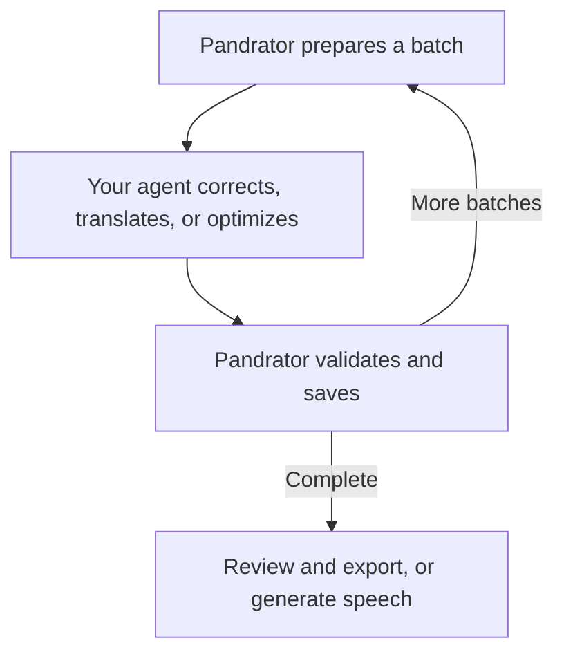

  

# Pandrator

**Make audiobooks, subtitles, voiceovers, sounds, and music in one workspace.**

Turn a book into something you can listen to. Transcribe a recording, translate
its subtitles, or give it a new voice. Add sound effects and background music.
Pandrator brings the steps together in a browser interface, with room to review
and refine the result as you go.

Run speech and transcription models on your own computer, connect a cloud
provider, or let your AI assistant help through MCP. Start with one workflow
and add more when you need them.

The [quick model guide](#choosing-your-first-speech-model) and
[broader model and language matrix](#models-and-providers) help you choose a
voice, language, and setup that suit your computer.

Pandrator Manager installs the application and the engines you choose, then
opens Pandrator in your browser. Older workspace data can still be imported.
For the retired Qt desktop interface, use an
[older release](https://github.com/lukaszliniewicz/Pandrator/releases).

Windows 10/11 and Linux desktop · x86-64 · Pandrator 0.13.0 / Manager 0.9.30

[All downloads & release notes](https://github.com/lukaszliniewicz/Pandrator/releases/latest)
· [Installation help](docs/getting-started/installation.md)
· [User guides](docs/README.md)

## New in 0.13.0

- **Refine audiobook pacing.** Keep short dialogue exchanges together, split long sentences more carefully, and adjust pauses when assembling the audio.
- **Choose how EPUB content is read.** Set narration preferences for tables and illustration text, with better handling of footnotes and ruby readings.
- **Edit captions without re-recording.** Display-only edits preserve the spoken text and recordings. New subtitle exports use your current display text; historical wording remains available when you need it.
- **Keep related work together.** Organize projects in virtual folders and keep language versions under one project.
- **Use more local speech options.** audio.cpp 0.9.2 adds French PocketTTS and Voxtral TTS. Kokoro offers optional Japanese support with a separate dictionary download. Voxtral's weights are licensed for noncommercial use.

See the [0.13.0 release notes](https://github.com/lukaszliniewicz/Pandrator/releases/tag/v.0.13.0) and [detailed changes](docs/release-changes-0.13.0.md).

## Try your first workflow

1. **Download and run Pandrator Manager.** On Linux, make the AppImage
   executable first. Choose a parent folder; the Manager creates a `Pandrator`
   workspace inside it and opens the setup interface in your browser.
2. **Install Pandrator and the engine you need.** Start with one of the speech
   models below, or **CrispASR** for transcription. You can add other engines
   later. Docker, WSL, and a separate Python installation are not required.
3. **Make something small.** Choose **Generate an audiobook** and paste a
   short passage, or open **Quick Transcribe** to upload a clip or record your
   microphone. Listen, review, and save the result.

Local models download separately on first setup; speed and memory requirements
vary by engine and hardware. The Manager shows the available compute options.
The Windows launcher is currently unsigned, so Windows may show an unknown
publisher warning; the [installation guide](docs/getting-started/installation.md)
explains this and the release checksums.

### Choosing your first speech model

Choose a model that supports your text's language, then the voice controls and
hardware you need. These are useful starting points:

| Model | Recommended for | Documented speech languages |
| --- | --- | --- |
| [Kokoro 82M](https://huggingface.co/hexgrad/Kokoro-82M) | Fast generation and modest computers. CPU-friendly, with ready-made voices. | English (American and British), Mandarin Chinese, Japanese, Spanish, French, Hindi, Italian, Brazilian Portuguese |
| [Qwen3 TTS](https://github.com/QwenLM/Qwen3-TTS) through audio.cpp | Voice cloning with **Base**, or creating a voice from a description with **VoiceDesign**. A useful next step on modest hardware. | Mandarin Chinese, English, Japanese, Korean, German, French, Russian, Portuguese, Spanish, Italian |
| [BreezeTTS 2](https://huggingface.co/BreezeBlue/Breeze-TTS-2) through audio.cpp | Voice design, expressive generation, and cloning from reference recordings for non-commercial projects. | English, Mandarin Chinese |

For AMD cards such as the **RX 480**, choose audio.cpp's **Vulkan** backend for
Qwen. Use a model package that fits your available memory and try a short passage
before a long book. CPU generation is also available; speed depends on the model,
package, and computer.

To reuse a designed voice, **describe it → audition candidates → save the chosen
sample in the Voice Library → select it for narration**. With Qwen, use
VoiceDesign to create the sample and Base to generate from that reference.
Breeze can design a voice, save it for later generation, or clone a voice from
a recording and its transcript. Record or upload your own clean reference samples
when you already have the voice you want.

Breeze's open weights and self-hosted outputs are for research and non-commercial
use. For other languages or voice options, compare the
[broader matrix](#models-and-providers), then filter the application's **Audio models**
catalogue by language and capability. See [providers and voices](docs/guides/providers-and-voices.md)
for setup and voice references.

## What would you like to make?

| Start with… | Make… | Guide |
| --- | --- | --- |
| A book, document, or pasted text | Narrated audio or an M4B audiobook with chapters and cover art | [First audiobook](docs/getting-started/first-audiobook.md) |
| An audio/video file or existing subtitles | Reviewed, corrected, or translated subtitles | [First subtitles](docs/getting-started/first-subtitles.md) |
| A video or subtitle file | Synchronized speech and a dubbed video | [First voiceover](docs/getting-started/first-voiceover.md) |
| A description or an audio clip | Reusable sound effects, music, and a mixed soundtrack | [Sounds and mixing](docs/reference/sounds-and-mixing.md) |
| A recording and optional captions | Transcript-guided cuts, reviewed boundaries, and an edited video | [Recording editing with MCP](pandrator_mcp/guides/workflows.md#media-editing) |
| A short clip or your microphone | A TXT, SRT, or JSON transcript without creating a session | [Quick Transcribe](docs/reference/quick-transcription.md) |

## Use the AI assistant you already have

If you use **Codex, Claude Code, OpenCode, or another MCP-capable host**, its
model can do Pandrator's language work directly. You do not need to configure
a separate LLM provider or API key in Pandrator for this route.

In a **passive MCP workflow**, Pandrator prepares and tracks the work; the
model in your existing conversation processes it and submits
results through MCP. “Passive” describes Pandrator's role: it does not make the
LLM calls itself.

Use it to:

- **Clean PDF/EPUB text** before audiobook preparation, with reviewable changes
  to document structure and extraction artifacts.
- **Correct and translate subtitles**, keeping cue identities and shared
  terminology across batches.
- **Optimize text for speech** before narration, while retaining the source
  wording as a separate artifact.
- **Coordinate a whole workflow**: import a file, process the text, select a
  voice, generate speech, and return verified deliverables.

After [connecting your MCP host](docs/operations/agent-connections.md), try a
request such as:

> Use Pandrator to correct this recording's English subtitles and translate
> them into Polish. Use your own model through passive dispatch, keep a shared
> glossary, and export both SRT files. Preserve uncertain wording for review.

Pandrator tracks batches, validates submissions, and keeps completed work so
an interrupted agent can resume. The agent must continue the tool loop;
starting a passive run alone does not process it. Speech recognition and
speech generation still use the engines you select in Pandrator.

Your host's normal usage limits and costs apply. If its model runs in the
cloud, the text it processes is sent there, even when Pandrator runs locally.

See the [passive workflow guide](docs/guides/passive-dispatch.md),
[end-to-end agent guide](docs/guides/agent-workflows.md), and the
[reusable workflow skill](pandrator_mcp/skills/pandrator-workflows/SKILL.md).
The skill adds workflow guidance; the MCP connection supplies the tools.
See [skill installation](pandrator_mcp/README.md#optional-workflow-skill) to add it
to your host.

## Features in more detail

### Audiobooks and narration

- Import TXT, PDF, EPUB, DOCX, MOBI, or pasted text. MOBI conversion needs
  optional Calibre.
- Prepare documents with extraction, OCR, chapter detection, text cleanup,
  and optional AI assistance.
- Adjust pronunciation and speech text, generate in segments, compare takes,
  and regenerate selected passages.
- Assign character voices and delivery directions. After changing the cast,
  regenerate the affected recordings and compare the saved Before and After
  audio versions.
- Record or upload voice references and retain their transcripts.
- Export WAV, MP3, Opus, FLAC, or M4B, with audiobook chapters, metadata,
  and cover art where the format supports them.
- Export a video book with timed reading text, or save timed subtitles alongside
  the narration.

### Sounds and music

- Generate sound effects or music from a description, or import your own clips.
  Available controls, including lyrics, depend on the selected model.
- Save clips and alternate versions in a searchable library for reuse.
- Place effects around spoken passages and mix background music with narration
  or voiceovers. Adjust timing, volume, trim, and fades while retaining the
  original speech recordings.

See [sounds and mixing](docs/reference/sounds-and-mixing.md) and
[choosing a sound or music model](docs/reference/sound-and-music-models.md).

### Subtitles, voiceovers, and recording edits

- Transcribe audio/video with timestamps and optional speaker diarization.
- Import SRT; WebVTT, ASS, and SSA uploads are also recognized, with SRT used
  as the working subtitle format.
- Correct, translate, split, merge, and retime cues in a reviewable editor.
  Use manual edits, configured language providers, or passive MCP processing.
- Generate synchronized speech and export media with selectable audio and
  subtitle tracks, including burned-in subtitles.
- Plan recording cuts from a transcript, inspect and refine their boundaries,
  and render a reviewed edit while preserving the original media.

### Quick transcription and automation

- Upload audio/video or record and preview your microphone, then copy or
  download TXT, SRT, or JSON without creating a permanent session.
- Transcribe through HTTP or MCP: an approved-root file path or a small
  base64-encoded clip can be supplied through MCP. Larger files are streamed
  from the host rather than placed in the model's context.
- Quick transcripts are temporary and expire one hour after completion;
  save the result you want to keep.
- Use MCP for session workflows, live voice/model selection, reviewable plans,
  resumable work, and downloads verified by size and checksum.

## Models and providers

This broader matrix covers the main speech models and providers. Language lists
can differ between checkpoints, voices, and cloud models. “Listed” coverage means
languages described in Pandrator's catalogue; a model can have broader upstream
claims, and pronunciation quality still varies. Open **Audio models** for the full
list and filter by the language and voice controls you need. Speech recognition
and word alignment have separate language coverage.

### Local speech generation

**audio.cpp is a local speech provider with several models to choose from,
and the default for new workspaces.** Select the model packages you want to
install in the Manager, then choose an installed model in **Generate audio**
settings. You can switch models or add more later. Available families include:

| audio.cpp model family | Voice options | Speech language coverage |
| --- | --- | --- |
| **Qwen3 TTS** | Base for cloning; CustomVoice for built-in speakers; VoiceDesign for a described voice. | Ten languages; see the quick guide above. Choose the appropriate Base, CustomVoice, or VoiceDesign package. |
| **Fish Audio S2 Pro** | Expressive reference-voice cloning. | 83 languages reported by the model, including English, Mandarin Chinese, French, German, Spanish, Polish, and Dutch. |
| **VoxCPM2** | Reference-voice cloning and described voices on supported packages. | 30 listed languages, including English, Mandarin Chinese, Japanese, Korean, French, German, Polish, and Dutch. |
| **Chatterbox** | Reference-voice cloning; Turbo has its own voice and vocal-event controls. | 19 listed languages in the multilingual package; Turbo is English-only. |
| **MagpieTTS** | Preset multilingual voices. | English, Arabic, Mandarin Chinese, French, German, Spanish, Hindi, Italian, Korean, Brazilian Portuguese, and Vietnamese; choices depend on the voice. |
| **OmniVoice** | Reference-voice cloning and described voices on supported packages. | Hundreds of languages; the main package lists 646 language entries. Related checkpoints can have narrower coverage. |
| **PocketTTS** | Preset voices and reference-voice cloning. | Separate English, German, Italian, Portuguese, and Spanish checkpoints; choose the one for your text. |
| **FireRedTTS3 Base** | Experimental reference-voice cloning. | 24 listed languages, including English, Mandarin Chinese, Cantonese, Japanese, Korean, Polish, and Dutch. |
| **BreezeTTS 2** | Voice design, generation from saved designs, and reference-voice cloning. | English and Mandarin Chinese; open weights and self-hosted outputs are for non-commercial use. |

The Manager supplies model packages with their supported compute options.
CPU, Vulkan, and CUDA builds are available; the Linux CUDA build is currently
best-effort and has not been verified on NVIDIA hardware. Available voices and
languages depend on the selected model.

These dedicated providers also remain available:

| Provider | Voice options and capabilities | Speech language coverage |
| --- | --- | --- |
| **Kokoro-82M v1.0** | Lightweight, CPU-friendly preset voices; a useful first narration engine. | Eight documented languages; see the quick guide above. |
| **Silero** | CPU-friendly language-specific voice packs; licence terms differ by pack. | Choose a pack for the required language or accent. |
| **XTTS v2** | Multilingual and cross-language voice cloning; optional fine-tuned model imports and training. | 17 languages, including English, Mandarin Chinese, Japanese, French, German, Spanish, Polish, and Dutch. |
| **Voxtral** | Preset voices; requires a supported GPU/WGPU backend. | Arabic, English, French, German, Hindi, Italian, Dutch, Portuguese, and Spanish. |

Existing workspaces keep their saved defaults and provider selections.
Standalone Qwen3 TTS, Fish S2 Pro, VoxCPM2, Chatterbox, and Magpie providers
remain supported for compatibility. Installed components stay manageable;
uninstalled ones appear under **Compatibility backends**. In a saved session,
**Switch to audio.cpp** proposes a matching model family for review. Voices and
engine settings are not assumed interchangeable, and existing takes remain
intact. See [switching providers](docs/guides/providers-and-voices.md#switching-from-a-compatibility-provider).

Optional **RVC** converts the voice of generated audio, keeping the original
and converted takes available. It is a separate post-processing step.
XTTS training benefits strongly from an NVIDIA GPU.

### Transcription and alignment

| Runtime / provider | Models and capabilities |
| --- | --- |
| **CrispASR (local)** | **Whisper large-v3** for multilingual transcription, **Parakeet TDT 0.6B v3** with native word timing, and **MOSS Transcribe-Diarize 0.9B** with speaker diarization. |
| **Qwen3 ASR / ForcedAligner through audio.cpp (local)** | Multilingual transcription and alignment of accepted captions; selectable model packages and language controls. |
| **Canary CTC (local)** | Forced alignment for existing captions and MOSS word timing; aligns text to audio. |
| **Azure Speech (cloud)** | **MAI-Transcribe-2** and **MAI-Transcribe-1.5**, with word timing; these profiles do not provide diarization. |

### Cloud speech and external servers

| Provider | Voice options | Speech language coverage |
| --- | --- | --- |
| **OpenAI** | Preset voices with `gpt-4o-mini-tts`, `tts-1`, and `tts-1-hd`. | 57 listed languages, including English, Mandarin Chinese, French, German, Japanese, Polish, and Dutch. |
| **Google Gemini / Vertex AI** | Preset voices and custom voice creation on supported models. | Multilingual, including English, Mandarin Chinese, French, German, Spanish, Polish, and Dutch; the full list depends on the model and route. |
| **ElevenLabs** | Account voices, cloning, and voice design through the native integration. | Depends on the model; Multilingual v2 lists 29 languages, while newer models offer broader coverage. |
| **Azure Speech** | MAI Voice 2.1 and MAI Voice 2.1 Flash preset voices. | Depends on the selected model and voice; the catalogue shows the available languages and locales. |
| **External servers** | OpenAI-compatible or generic JSON endpoints, with profiles for Piper, StyleTTS2, Matcha-TTS, Open Unified TTS, and Azure OpenAI deployments. | Determined by the model and voices served by that endpoint. |

Cloud access depends on your provider account and available models. External
servers are connections to separately operated services; they are not all
Manager-installable engines.

### Language models and translation

Use **OpenAI, Anthropic, Google Gemini, OpenRouter, Groq, Mistral AI,
Azure OpenAI, Google Vertex AI, or Amazon Bedrock**, or connect a local
**LM Studio, Ollama, or OpenAI-compatible server**. Model selection follows
the provider's catalogue or your configured model ID.

Correction, glossary-aware translation, document cleanup, and speech-text
optimization can use a configured LLM. **DeepL** is also available for
translation. The passive MCP route above lets your existing host model do
language work instead.

The [providers and voices guide](docs/guides/providers-and-voices.md) covers
setup, compute choices, voice references, and model imports.

## Your computer, your choice of providers

Local speech and transcription engines can keep processing on your own
machine. Cloud speech, language, and translation services are optional; their
selected inputs are sent to those providers. Model language coverage, hardware
requirements, and licences differ. Check the engine's details before a long run.

Pandrator is designed for one owner and listens locally by default. You can
also run it on a home server or GPU host; follow the
[remote and headless guide](docs/operations/remote-and-headless.md) for setup
and the [privacy guide](docs/security/privacy-and-security.md) for data flows.

## Go further

| Topic | Documentation |
| --- | --- |
| Setup and step-by-step workflows | [Documentation index](docs/README.md) |
| Engines, voice references, and model imports | [Providers and voices](docs/guides/providers-and-voices.md) |
| PDF/EPUB extraction and cleanup | [Document ingestion](docs/reference/document-ingestion.md) |
| Correction, translation, and glossaries | [Language workflows](docs/guides/correction-and-translation.md) |
| Pronunciation and narration preparation | [Pronunciation](docs/guides/pronunciation-and-speech.md) · [Speech optimization](docs/reference/speech-optimization.md) |
| Character voices and delivery | [Generation controls](docs/reference/generation-controls.md) |
| Sound effects, music, and mixing | [Sounds and mixing](docs/reference/sounds-and-mixing.md) |
| Supported output formats | [Formats and exports](docs/reference/formats-and-exports.md) |
| Installation, updates, and repair | [Manager guide](pandrator_manager/README.md) |
| MCP connection and workflow skill setup | [MCP guide](pandrator_mcp/README.md) |

## Help and feedback

Stuck on setup? Start with [troubleshooting](docs/operations/troubleshooting.md).
Found a bug or have an idea? [Open an issue](https://github.com/lukaszliniewicz/Pandrator/issues)
with your operating system, engine/provider, and steps to reproduce it. For
installation or service failures, the Manager's **Download diagnostics** bundle
can help; inspect it before sharing.

## License

Pandrator's source code is available under the [MIT License](LICENSE).
Third-party models, dependencies, and providers have their own licences and
usage terms. Check those separately, and use source media and voice references
you have the rights to use.
